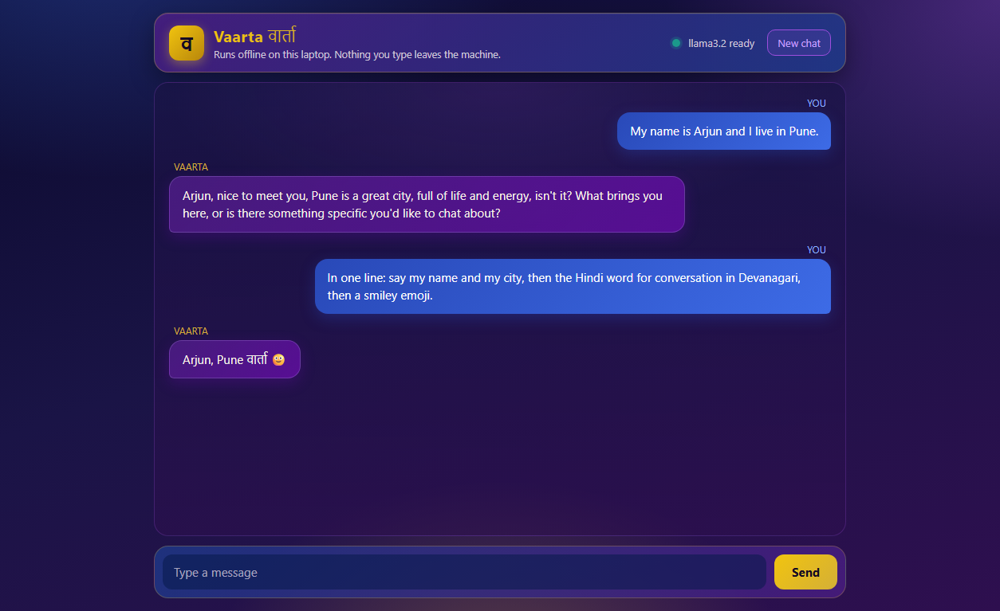

# Vaarta (वार्ता)

*Vaarta* is Sanskrit for "conversation". It is a chatbot that runs **fully offline on your own laptop**.
No API key, no account, no cloud, no cost. Once set up, it works with the internet switched off.

Most "AI chatbot" repos are thin wrappers around a paid API. Vaarta runs a real open model locally
through [Ollama](https://ollama.com) and shows the whole mechanism in a few short, commented files.



## How it works

There is no magic memory. The chatbot keeps a list called `messages`, adds every user message and
every reply to it, and sends the **entire list** to the model on each turn. That list is the memory.

Two faces, one brain:

- `main.py` is the terminal version. The whole loop is about 20 lines.
- `server.py` plus the `web/` folder is the browser version. The page keeps the same `messages`
  list in JavaScript and sends all of it on every request, so the server stores nothing.
- `vaarta.py` holds the model name, a startup check, and the one call that talks to the model. Both faces use it.
- `prompts.py` holds the system prompt, which is where Vaarta's personality lives.

## Requirements

- Windows, macOS or Linux
- Python 3.10+
- 8 GB RAM minimum, 16 GB recommended
- About 5 GB of free disk space (Ollama itself is about 3 GB, the model about 2 GB)
- No GPU needed (runs on CPU)

## Setup

1. Install Ollama from <https://ollama.com/download>. It runs in the background after install.
   If it shows a sign-up screen, choose **"No thanks, I'll use Ollama locally"**.
2. Pull the model (about 2 GB, one-time download):

   ```
   ollama pull llama3.2
   ```

3. Install the Python dependencies:

   ```
   pip install -r requirements.txt
   ```

## Run in the terminal

```
python main.py
```

Type your message and press Enter. Type `exit` to quit, or press Ctrl+C.

The first reply takes a few seconds while the model loads into memory. After that it is faster.

## Run in the browser

```
python server.py
```

Then open <http://127.0.0.1:5000>. Press Ctrl+C in the terminal to stop it.

The server listens only on your own machine, so nothing on your network can reach it.
Open the browser console (F12) and type `messages` to watch the conversation memory grow.

## Change the personality

Edit `prompts.py`. The last line picks which prompt is used; swap it to `PLAIN_PROMPT`
to see how much difference the system prompt makes.

## Which model?

The same seven questions were run through two models on a Ryzen 5 5600H laptop with 16 GB RAM, CPU only:

| Model | Size | Speed | Time for 7 answers | Followed the rules? |
|---|---|---|---|---|
| llama3.2 (3B) | 2.0 GB | ~18 tokens/s | 22 s | Yes: short, correct, code only when asked |
| mistral (7B) | 4.4 GB | ~8 tokens/s | 197 s | No: three times longer, added explanations to "code only" |

Both got the facts and the arithmetic right. The small model is the better default on a CPU.
To try another one, pull it and change `MODEL` at the top of `vaarta.py`:

```
ollama pull mistral
```

Then restart `main.py` or `server.py`. If the web page is open, refresh it so the status pill picks up the new model.

## Project layout

```
main.py           terminal face: the chat loop
server.py         web face: a small Flask server
vaarta.py         the brain: which model, a startup check, and the one call that talks to it
prompts.py        the system prompt (Vaarta's personality)
web/              index.html, style.css, app.js for the browser version
docs/             the screenshot shown at the top of this README
requirements.txt  Python dependencies
```
